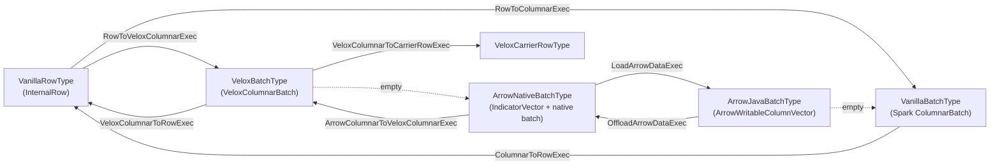

# Arrow Columnar Conversion in Gluten

This document describes how Gluten converts data between rows, Spark columnar batches, Java Arrow
batches, native Arrow batches and Velox batches today, and how to add a new operator that consumes
or produces Arrow batches, using the Lance scan offload
([#12958](https://github.com/apache/gluten/pull/12958)) as the example.

It reflects Gluten `main`. Changes that are proposed but not merged are marked as such, see
[Ongoing work](#ongoing-work). Background and diagrams:
[#12289](https://github.com/apache/gluten/issues/12289) (layout of the Arrow conversion) and
[#13140](https://github.com/apache/gluten/issues/13140) (Arrow UDF support, today vs. target).

## 1. Conventions

Every physical plan node in a Gluten query has a *convention*: the row type and the batch type it
outputs. Gluten never asks a node to convert its output itself. Instead, each type registers the
transitions to and from other types, and the planner inserts the transition operators between a
child and a parent whose conventions don't match.

| Concept | Code | Meaning |
|---|---|---|
| `Convention.RowType` | `gluten-core/.../transition/Convention.scala` | A row format. `VanillaRowType` is Spark's `InternalRow`; `None` means the node outputs no rows |
| `Convention.BatchType` | same | A columnar batch format. `VanillaBatchType` is Spark's `ColumnarBatch`; `None` means no batches |
| `ConventionReq` | `ConventionReq.scala` | What a parent requires from each child: `Any` or `Is(type)`, for rows and for batches |
| `Transition` | `Transition.scala`, `TransitionGraph.scala` | An edge of the graph: a function `SparkPlan => SparkPlan` that wraps the child with a converting operator, or `Transition.empty` when the data is already compatible |
| `ConventionFunc` | `ConventionFunc.scala` | Derives the convention of any plan, including vanilla Spark plans and plans through `QueryStageExec` / `ReusedExchangeExec` |

A type registers its transitions in `registerTransitions()` with `fromRow`, `toRow`, `fromBatch` and
`toBatch`. All edges form one graph, and the planner uses the shortest path between two types
(`FloydWarshallGraph`), so a conversion over several steps is assembled automatically.

How `ConventionFunc` derives a convention:

- A `GlutenPlan` declares it: `batchType()` and `rowType()`. `supportsColumnar` and
  `supportsRowBased` are derived from them and are `final`.
- A vanilla Spark plan gets `VanillaBatchType` if `supportsColumnar`, and `VanillaRowType` if it
  supports rows.
- Components can override both through `Component.convFuncOverride()`.

How the planner requires a convention from children (`conventionReqOf`):

- A `GlutenPlan` declares `requiredChildConvention()`. By default, children must have the parent's
  own convention; a node that supports both rows and batches requires only its batch type.
- `ColumnarToRowExec` requires `VanillaBatchType`; `RowToColumnarExec` and `UnionExec` require
  `VanillaRowType`.

`InsertTransitions` removes existing transitions, then for each node compares
`conventionReqOf(node)` with `conventionOf(child)` and applies the transition path found in the
graph.

## 2. Types and how batches look

### Types registered with the Velox backend

| Type | Defined in | Physical form | Notes |
|---|---|---|---|
| `VanillaRowType` | `gluten-core` | Spark `InternalRow` | |
| `VanillaBatchType` | `gluten-core` | Spark `ColumnarBatch` of any `ColumnVector` | Transitions are Spark's `RowToColumnarExec` / `ColumnarToRowExec` |
| `ArrowJavaBatchType` | `gluten-arrow` `ArrowBatchTypes` | *Heavy* batch: every column is an `ArrowWritableColumnVector`, whose data is in Java Arrow vectors | Readable from the JVM through the `ColumnVector` getters |
| `ArrowNativeBatchType` | `gluten-arrow` `ArrowBatchTypes` | *Light* batch: column 0 is an `IndicatorVector` holding the handle of a native `ColumnarBatch` (e.g. `ArrowCStructColumnarBatch`), the other columns are `PlaceholderVector`s | Not readable from the JVM |
| `VeloxBatchType` | `backends-velox` `VeloxBatchType` | Light batch whose native object is a `VeloxColumnarBatch` (a Velox `RowVector`) | |
| `VeloxCarrierRowType` | `backends-velox` `VeloxCarrierRowType` | Rows that carry a Velox batch | Used for row-based outputs that keep Velox data, e.g. for writes |

`ColumnarBatches` (`gluten-arrow/.../columnarbatch/ColumnarBatches.java`) tells heavy and light
batches apart, and holds the reference counts of both: `IndicatorVector` for light batches and
`ArrowWritableColumnVector` for heavy ones.

### Transition graph



Solid edges insert an operator; dotted edges (`Transition.empty`) insert nothing:

- **`ArrowJavaBatchType` → `VanillaBatchType` is empty** because `ArrowWritableColumnVector` is a
  Spark `ColumnVector`. A vanilla consumer such as `ColumnarToRowExec` reads Gluten's Java Arrow
  batches directly.
- **`VeloxBatchType` → `ArrowNativeBatchType` is empty** because a `VeloxColumnarBatch` is a native
  `ColumnarBatch` that can export itself as Arrow C data, which is all that `ArrowNativeBatchType`
  promises.

Composite paths that the planner builds from these edges:

| From → To | Operators inserted |
|---|---|
| Velox → Java Arrow | `LoadArrowDataExec` (Velox → Arrow native is empty) |
| Java Arrow → Velox | `OffloadArrowDataExec` → `ArrowColumnarToVeloxColumnarExec` |
| Java Arrow → rows | `ColumnarToRowExec` (Java Arrow → vanilla batch is empty) |
| Rows → Java Arrow | `RowToVeloxColumnarExec` → `LoadArrowDataExec` |
| Velox → rows | `VeloxColumnarToRowExec` |

## 3. What each transition does

| Transition | Implementation | What happens to the data |
|---|---|---|
| `LoadArrowDataExec` (native → Java Arrow) | `ColumnarBatches.load` | The native batch exports Arrow C structs (`ColumnarBatchJniWrapper.exportToArrow`). For a Velox batch, `VeloxColumnarBatch::exportArrowArray` first flattens dictionary and constant vectors (`ensureFlattened`), then calls `velox::exportToArrow`. Java imports the arrays into `ArrowWritableColumnVector`s (`ArrowAbiUtil.importToSparkColumnarBatch`) |
| `OffloadArrowDataExec` (Java Arrow → native) | `ColumnarBatches.offload` | Java exports the vectors as Arrow C structs (`ArrowAbiUtil.exportFromSparkColumnarBatch`), and native wraps them as an `ArrowCStructColumnarBatch` (`createWithArrowArray`). No copy |
| `ArrowColumnarToVeloxColumnarExec` (native Arrow → Velox) | `VeloxColumnarBatches.toVeloxBatch` → `VeloxColumnarBatch::from` | `velox::importFromArrowAsOwner` builds a Velox `RowVector` that owns the Arrow buffers |
| `RowToVeloxColumnarExec` / `VeloxColumnarToRowExec` | `backends-velox` | Converts between rows and Velox vectors (always copies) |
| `ColumnarToRowExec` over Java Arrow | Spark | Reads rows through `ArrowWritableColumnVector`'s getters |

### Copies on the Arrow path

| Step | Fixed-width columns | Strings | Dictionary / constant vectors |
|---|---|---|---|
| Velox → Java Arrow (`load`) | No copy | Copied: Velox's `StringView` layout is exported as an Arrow string array, since Arrow string views aren't enabled | Flattened (copied) |
| Java Arrow → native Arrow (`offload`) | No copy | No copy | Not used |
| Native Arrow → Velox | No copy | A new `StringView` buffer is built (strings of 12 bytes or less are inlined) | Not used |

### Batch lifecycle

- `load`, `offload` and `toVeloxBatch` convert **in place**: the new vectors are moved into the
  input `ColumnarBatch` object (`SparkColumnarBatchUtil.transferVectors`), and the output keeps the
  input's reference count. Code that holds the input object sees the converted batch.
- A batch is released with `ColumnarBatches.release` or `ColumnarBatch.close()`, which decrements
  the reference count of its vectors. An operator that needs a batch after its child has moved on
  must retain it (`ColumnarBatches.retain`) and release it later, as `ColumnarArrowEvalPythonExec`
  does.
- `ColumnarToColumnarExec` closes the batches it emits on the next call only when
  `needRecyclePayload` is true (e.g. `VeloxResizeBatchesExec`). The Arrow transitions keep the
  default, `false`.
- Java Arrow memory comes from `ArrowBufferAllocators.contextInstance()`, Gluten's per-task
  allocator, whose listener reports to Spark's memory manager.

## 4. Arrow-based operators today

| Operator | Batch type in → out | How it's planned |
|---|---|---|
| `ColumnarArrowEvalPythonExec` (Arrow / pandas UDFs) | Java Arrow → Java Arrow | Gluten's own operator and Python runner, from `OffloadSingleNodeRules` |
| `ColumnarPartialProjectExec`, `ColumnarPartialGenerateExec` | Velox → Velox | Load to Java Arrow inside the operator, evaluate the Spark expressions row by row, and write the results with `ArrowProjection` |
| `ColumnarRangeExec` | – → Java Arrow | Builds `ArrowWritableColumnVector`s in the JVM |
| `VeloxRDDScanTransformer`, `VeloxLocalTableScanTransformer` | – → Velox | Write rows into `ArrowWritableColumnVector`s, then convert them to Velox inside the operator |
| `LanceScanTransformer` (`-Plance`) | – → Java Arrow | Imports an Arrow C stream from lance-spark |

Any other Spark operator that wants Arrow, such as `MapInArrowExec` or `FlatMapGroupsInArrowExec`,
is a vanilla row-based plan to Gluten, so Gluten plans `VeloxColumnarToRow → Spark operator →
RowToVeloxColumnar` around it.

## 5. Adding an Arrow-based columnar operator

The Lance scan offload ([#12958](https://github.com/apache/gluten/pull/12958)) is a complete,
small example: a leaf operator that produces Java Arrow batches from an external Arrow C stream,
and leaves every conversion to the planner. Its files:

| File | Role |
|---|---|
| `backends-velox/src-lance/main/scala/.../execution/LanceScanTransformer.scala` | The operator and its RDD |
| `backends-velox/src-lance/main/scala/.../extension/OffloadLanceScan.scala` | The rule that replaces `BatchScanExec` |
| `backends-velox/src-lance/main/scala/.../component/VeloxLanceComponent.scala` | Registers the rule when lance-spark is on the classpath |
| `backends-velox/src-lance/main/resources/META-INF/gluten-components/...VeloxLanceComponent` | Makes the component discoverable |
| `backends-velox/src-lance/test/scala/.../VeloxLanceSuite.scala` | Plan shape, results and fallback tests |
| `pom.xml`, `backends-velox/pom.xml` | `lance` / `lance-test` profiles that add `src-lance` |

### Step 1: Declare the convention

Implement a `GlutenPlan` (usually through `ValidatablePlan`) and declare what it outputs and
requires:

```scala
case class MyArrowExec(child: SparkPlan) extends UnaryExecNode with ValidatablePlan {
  override def batchType(): Convention.BatchType = ArrowJavaBatchType
  override def rowType(): Convention.RowType = Convention.RowType.None
  // The default requires the children to have this node's convention, here ArrowJavaBatchType.
  // Override it only if the operator accepts something else.
  override def requiredChildConvention(): Seq[ConventionReq] =
    Seq(ConventionReq.ofBatch(ConventionReq.BatchType.Is(ArrowJavaBatchType)))

  override protected def doExecute(): RDD[InternalRow] =
    throw new UnsupportedOperationException(s"$nodeName does not support row-based execution.")
  override protected def doExecuteColumnar(): RDD[ColumnarBatch] = ...
}
```

Don't insert `LoadArrowDataExec`, `OffloadArrowDataExec` or `ArrowColumnarToVeloxColumnarExec`
yourself. With these declarations `InsertTransitions` produces, for example:

- Velox child → your operator: `LoadArrowDataExec` is added below it.
- Your operator → Velox parent: `OffloadArrowDataExec` → `ArrowColumnarToVeloxColumnarExec` is
  added above it.
- Your operator → vanilla row parent: only `ColumnarToRowExec`, with no Velox round trip.

### Step 2: Produce batches that Gluten can own

The batches you emit are offloaded and closed by the transitions downstream, so each batch must
own its data:

- **Build the columns as `ArrowWritableColumnVector`s** (`ArrowWritableColumnVector.loadColumns`
  over `FieldVector`s). `ColumnarBatches` rejects other vectors in a Java Arrow batch.
- **Allocate from `ArrowBufferAllocators.contextInstance()`.** This keeps the memory accounted by
  Spark, and keeps the vectors in the allocator tree that `offload` expects.
- **Don't emit vectors that a reader reuses.** An `ArrowReader` (e.g. from `Data.importArrayStream`)
  loads every batch into the same `VectorSchemaRoot`. Lance transfers each vector out of the root
  before wrapping it (`getTransferPair(allocator).transfer()`), which moves the buffers without a
  copy and lets the batch outlive the reader.
- **Close what you emit.** Lance wraps its iterator with
  `Iterators.wrap(...).recyclePayload(_.close())`, like `ColumnarRangeExec`.
- **Release native resources early and on task end.** Close a reader as soon as it's exhausted,
  and add a `TaskContext` completion listener as a safety net for `LIMIT` and failures. Make
  `close()` idempotent.
- **Cross library boundaries with C structs only.** If the source has its own Arrow Java build,
  pass the address of the `ArrowArrayStream` / `ArrowArray` and wrap it with Gluten's Arrow
  (`ArrowArrayStream.wrap(address)`). Lance does this so that lance-spark and Gluten can use
  different Arrow versions.

For an operator with a child (e.g. a UDF operator), the input batch is valid only until the next
call on the child iterator. If you keep it longer, for example until a result comes back, call
`ColumnarBatches.retain` on it and `ColumnarBatches.release` once you're done.

### Step 3: Validate and fall back

Only offload what the operator can run. Check unsupported cases at planning time, not at run time:
once a node is offloaded, an exception fails the query instead of falling back. Lance keeps a scan
on vanilla Spark when it has a pushed aggregation or a full-text query
(`LanceScanTransformer.isExportable`). Put further checks in `doValidateInternal()`.

### Step 4: Write the offload rule

Implement `OffloadSingleNode` and inject it with a validator, so that the rule only fires for
plans that pass validation:

```scala
case class OffloadMyOperator() extends OffloadSingleNode {
  override def offload(plan: SparkPlan): SparkPlan = plan match {
    case p: SomeSparkExec if MyArrowExec.isSupported(p) => MyArrowExec(p.child)
    case other => other
  }
}

object OffloadMyOperator {
  def inject(injector: Injector): Unit = {
    injector.gluten.legacy.injectTransform {
      c =>
        val offload = Seq(OffloadMyOperator())
        HeuristicTransform.Simple(
          Validators.newValidator(new GlutenConfig(c.sqlConf), offload),
          offload)
    }
  }
}
```

### Step 5: Register a component (for optional dependencies)

If the operator depends on a library that isn't always present, register it as a `Component`:

- `dependencies()`: e.g. `classOf[VeloxBackend] :: Nil`.
- `isRuntimeCompatible`: check that the library is on the classpath (Lance checks for
  `org.lance.spark.read.LanceScan`), so the default bundle can ship the component.
- `injectRules(injector)`: call the rule's `inject`.
- List the class in `src-xxx/main/resources/META-INF/gluten-components/<class name>`.
- Put the sources under `backends-velox/src-xxx` behind a Maven profile, like `src-lance` and
  `src-iceberg`. Exclude the library's transitive Arrow so Gluten's Arrow version is kept.

### Step 6: Test

Cover at least the following, as `VeloxLanceSuite` does:

- The node is offloaded, and the plan has the expected transitions: none to a vanilla row consumer,
  and `OffloadArrowDataExec` → `ArrowColumnarToVeloxColumnarExec` to a Velox consumer.
- Results match vanilla Spark over several batches and several partitions, with nulls.
- `LIMIT` and other early stops release native resources.
- Unsupported cases fall back to vanilla Spark.

Add the profile to the CI job that runs the suite, and a page under
`docs/get-started/` if users have to enable anything.

### Checklist

- [ ] `batchType()` / `rowType()` / `requiredChildConvention()` declared; no transitions inserted
      by hand
- [ ] Columns are `ArrowWritableColumnVector`s from `ArrowBufferAllocators.contextInstance()`
- [ ] Emitted batches own their buffers; reused reader vectors are transferred first
- [ ] Input batches kept beyond the next call are retained and released
- [ ] Resources released on exhaustion and on task completion
- [ ] Unsupported cases rejected at planning time
- [ ] Rule injected with a validator; component gated on the classpath
- [ ] Tests for plan shape, results, early stop and fallback

## Ongoing work

These change parts of the above once merged:

- [#13280](https://github.com/apache/gluten/pull/13280) replaces `ArrowWritableColumnVector` with
  `RefCountedArrowColumnVector`, a subclass of Spark's `ArrowColumnVector`, and replaces
  `ArrowProjection` with Spark's `ArrowWriter`. New operators then build columns with
  `ArrowColumnVectors.toBatch(root)` / `ArrowColumnVectors.fromRows(...)`. `offload` also accepts
  batches of plain Spark `ArrowColumnVector`s, which it moves (same allocator root) or copies into
  Gluten's allocator.
- SPARK-57468 ([apache/spark#59154](https://github.com/apache/spark/pull/59154)) adds conventions to
  Spark itself, with an `ArrowBatchType`. With the prototype bridge in
  [#13140](https://github.com/apache/gluten/issues/13140), `ArrowJavaBatchType` is bound to Spark's
  `ArrowBatchType`, so a Spark operator that declares `ArrowBatchType` gets Gluten's transitions
  without a Gluten operator. Gluten's own `ColumnarArrowEvalPythonExec` and Python runner are then
  replaced by Spark's `ArrowEvalPythonExec`.
- Spark's batch ownership rules for Arrow vectors are still being settled upstream (SPARK-60294,
  SPARK-60306, SPARK-60325). Operators that keep Arrow batches across calls should follow them once
  merged.
